<!-- Header banner (animated wave) -->

  

<!-- Typing animation -->

  

<!-- Live badges: counts update automatically from GitHub search -->

  
  
  

---

### 👋 About me

- 🎓 Final-year B.Tech CSE student (graduating Aug 2027)
- ⚡ Contributing to **[CircuitVerse](https://github.com/CircuitVerse/CircuitVerse)**: Rails backend, CI and security fixes, and the Vue/TypeScript simulator
- 🔢 Contributing to **[stdlib-js](https://github.com/stdlib-js/stdlib)**: math and stats functions, C implementations, ULP-based numerical tests
- 🤖 Building developer tools with AI agents (LangGraph, MCP)
- 📫 Open to **software engineering internships**. Reach me at **aryan002005@gmail.com**

---

### ⚡ Open source highlights

**CircuitVerse** (Ruby on Rails · Vue · TypeScript)

| What | PR |
| --- | --- |
| Unblocked CI on every open PR when Ruby 4.0.2 vanished from ubuntu-26.04 runners | [#8110](https://github.com/CircuitVerse/CircuitVerse/pull/8110) |
| Resolved CVE advisories flagged by bundler-audit (view_component, websocket-driver, css_parser, crass, sanitize, avo) | [#7644](https://github.com/CircuitVerse/CircuitVerse/pull/7644) · [#8073](https://github.com/CircuitVerse/CircuitVerse/pull/8073) · [#8090](https://github.com/CircuitVerse/CircuitVerse/pull/8090) |
| Fixed a Ruby 4.0 compatibility break in LTI specs (`CGI.parse`) | [#7397](https://github.com/CircuitVerse/CircuitVerse/pull/7397) |
| Fixed search returning no results and added a "No circuits found" state | [#7430](https://github.com/CircuitVerse/CircuitVerse/pull/7430) · [#7423](https://github.com/CircuitVerse/CircuitVerse/pull/7423) |
| Converted simulator modules to TypeScript | [#1438](https://github.com/CircuitVerse/cv-frontend-vue/pull/1438) |

**stdlib-js** (JavaScript · C)

| What | PR |
| --- | --- |
| Added single-precision math functions `round10f`, `round2f`, `roundsdf`, `truncsdf` | [#9525](https://github.com/stdlib-js/stdlib/pull/9525) · [#9695](https://github.com/stdlib-js/stdlib/pull/9695) · [#9866](https://github.com/stdlib-js/stdlib/pull/9866) · [#10606](https://github.com/stdlib-js/stdlib/pull/10606) |
| Migrated 40+ test suites to ULP-based floating-point assertions | [see all](https://github.com/pulls?q=author%3Aaryan7071+is%3Apr+is%3Amerged+repo%3Astdlib-js%2Fstdlib+ULP) |

---

### 🚀 Featured projects

| Project | What it does | Stack |
| --- | --- | --- |
| **PR Sentinel** | Autonomous GitHub PR-review agent: parallel security, logic and test reviewers, a human approval gate, and all writes routed through a custom MCP server with scoped tokens. Includes an eval harness that measures reviewer precision and recall | Python · LangGraph · MCP · Docker · Prometheus · Grafana |
| **Distributed Task Scheduler** | Microservices scheduler with a priority-based job queue, delayed execution, retries and fault tolerance, plus full monitoring | Go · Kafka · Redis · PostgreSQL · Prometheus · Elasticsearch |

<b>More projects</b>

| Project | Description | Stack |
| --- | --- | --- |
| **HelpEd** | Educational platform focused on learning accessibility | React · Node.js · MongoDB |
| **Password Manager** | Secure password management web app | React · Express · MongoDB |
| **URL Shortener** | URL shortening service with a backend API | Next.js · Node.js |
| **Proactive Health Monitoring** | Monitors health data to flag potential outbreaks | React · Python |

---

### 🛠️ Tech stack

  
   
  
   
  

---

### 📊 GitHub stats

<!-- These SVGs are generated daily by .github/workflows/profile.yml and stored in this repo, so they never hit public rate limits -->

  
  

<!-- Contribution snake animation (also generated by the workflow) -->

  <picture>
    <source media="(prefers-color-scheme: dark)" srcset="./profile/snake-dark.svg"/>
    <source media="(prefers-color-scheme: light)" srcset="./profile/snake.svg"/>
    
  </picture>

---

### 🔗 Connect

  
  
  

<!-- Footer banner -->

  

